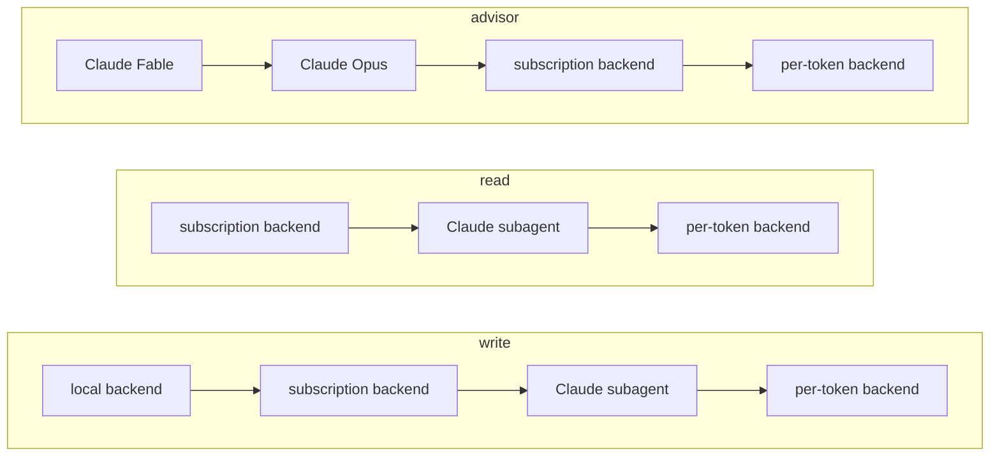

# skynet

A Claude Code plugin that delegates work to Codex, Antigravity (`agy`), OpenRouter or local Ollama. It picks the backend from live usage (codexbar) and the machine's billing setup, so Claude and Codex quota lasts longer. Workers edit the tree directly and keep their own scratch files in a per-job temp dir (`$TMPDIR/skynet-job-<job id>`), so only the files a brief asks for change; the lead reviews the diff.

## Needs

- `node` 22+, `python3`, `git`
- [`codexbar`](https://github.com/steipete/CodexBar) for usage
- one or more of `codex`, `agy`, `opencode`, `ollama`. Ollama runs through `codex exec --oss`, so it needs `codex` too. OpenRouter runs through `opencode run` and needs `OPENROUTER_API_KEY`.

## Install

```bash
claude plugin marketplace add CornelB/SkyNET-marketplace
```

```bash
claude plugin install SkyNET-agents@SkyNET-marketplace
```

Then run `/skynet:setup`.

## Use

| Command | Does |
|---------|------|
| `/skynet:setup` | Detect backends, save which may be used and how each is paid. |
| `/skynet:workflow <task>` | Plan a fan-out: each piece goes to you, a Claude subagent (model and effort set) or an external worker. |
| `/skynet:orchestrate <feature>` | Make this session the orchestrator of a feature built by worker sessions, one lane per repository: scope gate, worker briefs, five-line reports, state file. |
| `/skynet:delegate <task>` | Route, brief and start one or more jobs. |
| `/skynet:status [job]` | One line per job: backend, mode, status, branch and merge state for write jobs, title. A running job whose worker died shows as failed. |
| `/skynet:result [job]` | Show a finished job's output. |
| `/skynet:cancel [job]` | Stop a running job. |
| skill `skynet:usage` | Usage lines from codexbar. |
| agent `skynet:delegate` | The same delegation as a subagent type. |
| agent `skynet:git-summarizer` | Summarizes long git logs and diffs. Read-only, haiku. |
| agent `skynet:log-reader` | Returns only the relevant errors from a long log. Read-only, haiku. |
| agent `skynet:web-lookup` | Answers one factual question from the web, with sources. Haiku. |

Configuration and routing rules: [docs/reference/configuration.md](docs/reference/configuration.md).

## Tiers

A job asks for a tier (`delegate --tier`), named after the Claude families. Each backend serves a tier with a model family, and skynet runs the newest version of that family the backend lists. The map below is built in, so a new install needs no setup for it; `setup --map` replaces a tier for one backend.

|                  | Haiku | Sonnet | Opus | Fable |
|------------------|-------|--------|------|-------|
| Claude           | Haiku | Sonnet | Opus | Fable |
| OpenAI (`codex`) | Luna  | Terra  | Sol  | Astra |
| Google (`agy`)   | Flash | Hydrogen | Neon | Neon, then Carbon |
| OpenRouter       | -     | -      | -    | -     |
| Ollama           | -     | -      | -    | -     |

Ollama and OpenRouter models vary per setup. Ollama serves the tier `OLLAMA_CODING_MODEL_TIER` declares, and every tier below it. OpenRouter joins a funnel only with a saved map.

A backend serves a job when it has a model of the job's tier or a higher one.

## Funnels

Each job walks the funnel of its role and takes the first step that serves its tier and is not skipped. A step is skipped when its weekly window is above 80% or its 5h window is at 90% or more; a per-token backend is never skipped on quota. A backend that already runs its limit of jobs (two by default, one for a local backend) is skipped too. When the Claude subagent step is the answer, skynet starts no job and the session runs the piece itself.



- A local backend takes write jobs only, when its server is free.
- A write job that must run builds or tests skips a backend whose shell is read-only.
- The advisor asks for the Fable tier; Claude Fable is skipped when its own weekly window is above 80%.

Every rule and status line: [docs/reference/configuration.md](docs/reference/configuration.md). Design: [docs/specs/2026-11-22-tiered-funnels.md](docs/specs/2026-11-22-tiered-funnels.md).

## License

MIT. Parts of `scripts/lib/` derive from [openai/codex-plugin-cc](https://github.com/openai/codex-plugin-cc) (Apache-2.0); see [NOTICE](NOTICE).
